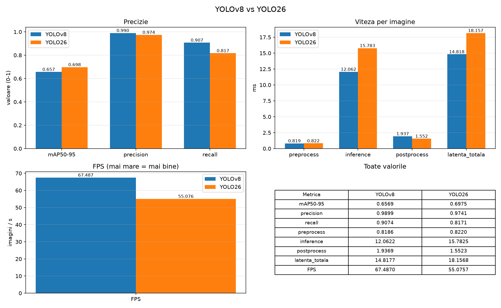

# Python Image Recognition

Computer vision experiments in Python: classic OpenCV techniques first, then my own YOLO object detection models trained on images I labelled myself.

<!-- Add a screenshot or GIF of a live detection here, e.g.  -->

## What's inside

### 1. OpenCV basics (`img*.py`)

| Script | What it does |
|---|---|
| `imgFundamentals.py` | Images as NumPy arrays: shape, reading pixels, copying a region, writing random pixels |
| `imgFunctions.py` | Load, resize, rotate and save an image |
| `imgDrawing.py` | Draw lines, rectangles, circles and text over the live webcam feed |
| `imgCameraCapture.py` | Webcam feed split into four tiles (two normal, two rotated 180°) |
| `imgColorDetect.py` | Colour detection with HSV masks (`cv2.inRange` + `bitwise_and`) |
| `imgCornerDetection.py` | Shi-Tomasi corner detection (`goodFeaturesToTrack`) on a chessboard, corners joined with random-colour lines |
| `imgTemplateMatching.py` | Finds a ball in a football picture with all six template-matching methods |
| `imgFaceEyeDetect.py` | Real-time face detection with a Haar cascade, then eye detection inside each face |

Test images are in `assets/`.

### 2. Custom YOLO models

All models start from a pretrained nano model and are fine-tuned on my own photos, labelled with bounding boxes and exported from Roboflow in YOLO format.

| Folder | Classes | Dataset (train / valid / test) |
|---|---|---|
| `Python_Antrenare_Fisiere_Casti/` | headphones (`CASTI`) | 107 / 31 / 15 images |
| `Python_Antrenare_Fisiere_Crema/` | hand cream | trained model only (`weights.pt`) |
| `Python_Antrenare_ObiecteMultiple/` | hand cream, Rubik's cube, super glue | 104 / 32 / 17 images |

Training settings: 50 epochs, 640 px images. The headphones model was trained both in Google Colab on a T4 GPU (`antrenare_casti.ipynb`) and locally on CPU (`antrenare.py`). The multi-class model was trained locally, on the NVIDIA GPU when available. `antrenare.py` reads the class names from `data.yaml` automatically, writes a local `data_local.yaml`, trains, evaluates on the test split and saves the test images with the predicted boxes.

Each detection is drawn as a bounding box with the class name and a confidence score between 0 and 1.

### 3. YOLOv8n vs YOLO26n

On the 3-class dataset I trained both `yolov8n` and `yolo26n` with the same settings (50 epochs, 640 px) and compared them on the test split (`Verificare.py`, `Tabel/Tabel.py`):

| Metric | YOLOv8n | YOLO26n |
|---|---|---|
| mAP50-95 | 0.657 | **0.698** |
| Precision | **0.990** | 0.974 |
| Recall | **0.907** | 0.817 |
| Total latency per image | **14.8 ms** | 18.2 ms |
| FPS | **67.5** | 55.1 |

On this small dataset YOLO26n draws tighter boxes (higher mAP50-95), while YOLOv8n finds more of the objects (higher recall) and runs faster on my laptop GPU.



## How to run

Requirements: Python 3, a webcam for the live scripts.

```bash
pip install opencv-python numpy ultralytics pyyaml matplotlib
```

OpenCV scripts:

```bash
python imgFaceEyeDetect.py   # press q to quit
```

Train a YOLO model: put `antrenare.py` next to `data.yaml` and the `train/ valid/ test/` folders of a Roboflow YOLO export, then run `python antrenare.py` (or double-click `Antrenare.bat` on Windows).

Live detection with the webcam: double-click `Detectie_Camera.bat` in a model folder, or run

```bash
yolo predict model=runs/model/weights/best.pt source=0 show=True conf=0.6
```

Note: `Verificare.py` uses absolute `D:\` paths; change `FOLDER` at the top to your own path.

## Tech

Python · OpenCV · NumPy · Ultralytics YOLO (v8, 26) · PyTorch · Roboflow · Matplotlib · Google Colab
